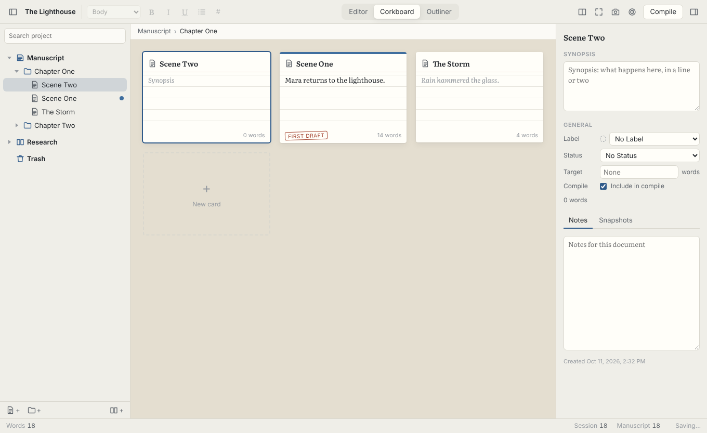
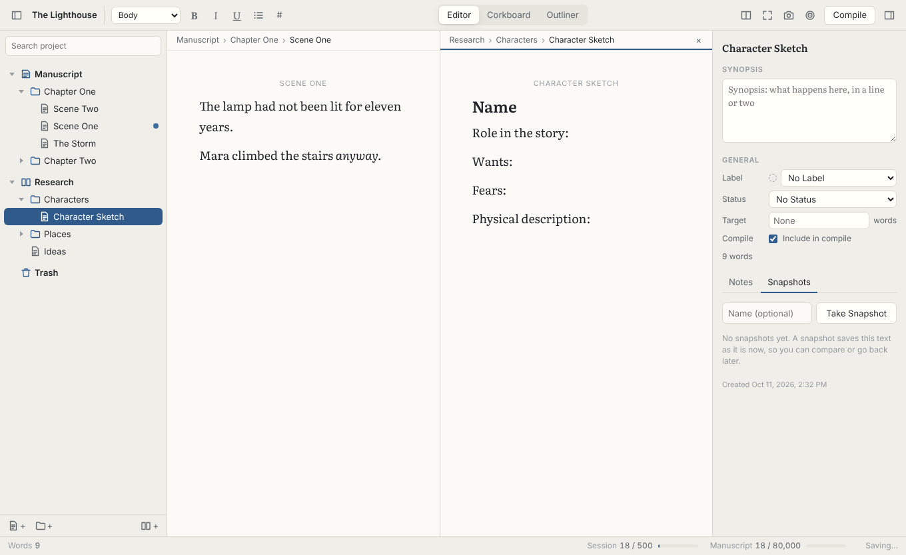
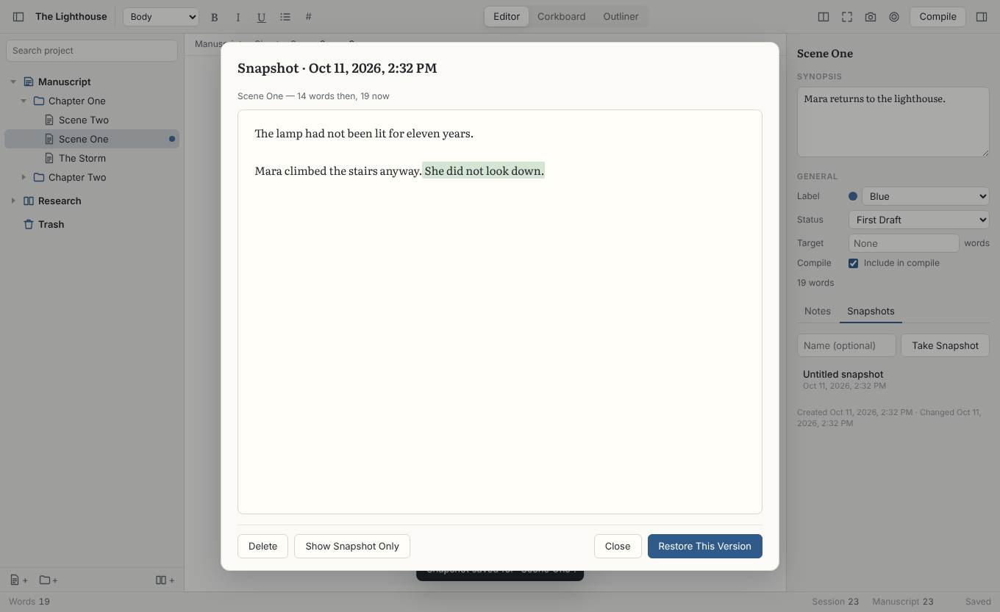
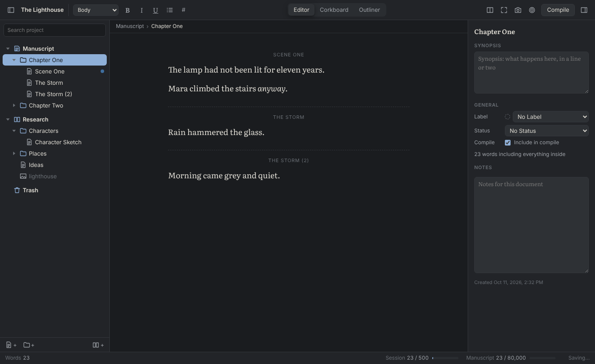

# Quire

A desktop writing studio for long projects like novels, theses and screenplays, in the spirit of Scrivener. You write in small pieces (scenes, chapters, notes), arrange them in a binder, see them as index cards or an outline, and compile the whole thing into one manuscript when you're ready.

Quire runs on macOS, Windows and Linux. Your work is saved as plain files on your own computer.



| Editor with a split view | Comparing a snapshot | Dark theme |
|---|---|---|
|  |  |  |

## What it does

- **Binder:** a tree of your manuscript, research and trash. You can drag items to reorder or nest them, rename them in place, and right-click for more. Searching the binder looks through titles, synopses and the full text.
- **Editor:** a quiet, serif writing page with bold, italic, underline, strikethrough, headings, block quotes, lists and scene breaks. Spellcheck is built in. Open a folder and its texts appear one after another so you can read and edit them as one piece, like Scrivener's "Scrivenings". **Split at Cursor** (⌘K) breaks a text in two.
- **Corkboard:** a folder's contents as index cards with title, synopsis, label color, status stamp and word count. Drag the cards to reorder the story.
- **Outliner:** the same contents as a table, with editable title, synopsis, label, status, word count, target and an "include in compile" box for each item.
- **Inspector:** the synopsis, label, status, word target and notes for the selected item, plus its snapshots.
- **Snapshots:** save a version of a text before a big revision, then compare it word by word with the current text, or restore it. Restoring snapshots the current text first, so nothing is lost.
- **Targets:** a word target and deadline for the manuscript, a daily session target (set it yourself or let Quire work it out from the deadline) and per-document targets, all with progress in the status bar.
- **Composition mode:** full screen with just the page. You can turn on typewriter scrolling, which keeps the line you're writing in the middle of the screen.
- **Split editor:** two documents side by side, for example a scene next to its character sketch.
- **Research:** import images, PDFs, audio and video into the Research folder and view them inside Quire. Research is never compiled.
- **Compile:** turns the Manuscript folder into Word (.docx), PDF, Markdown, plain text or a web page. You choose a title page, chapter headings from folder names, page breaks between chapters, the scene separator, the font, and what to include.
- **Templates:** Novel, Short Story, Non-fiction and Blank.
- Light and dark themes that follow your system, adjustable text size, and autosave.

## Download

Get the latest installer from [Releases](https://github.com/chapter57/quire/releases/latest).

## Running it

You need [Node.js](https://nodejs.org) 20 or newer.

```sh
npm install
npm start
```

## Building installers

```sh
npm run dist        # for the computer you're on
npm run dist:mac    # .dmg and .zip
npm run dist:win    # .exe installer
npm run dist:linux  # .AppImage and .deb
```

The installers are written to `dist/`. Every push to `main` also builds all three on GitHub Actions. To publish a version, push a tag such as `v0.1.0`: the installers then appear on the repository's **Releases** page.

The builds aren't code-signed yet. On a Mac, the first time you open Quire, right-click the app and choose **Open**. On Windows, choose **More info → Run anyway**.

## Tests

```sh
npm test            # unit tests: project files and compile
npm run test:e2e    # drives the real app through a writing session
```

On Linux without a display, run the end-to-end test as `xvfb-run -a npm run test:e2e`. Pass a folder (`node test/e2e/run.js shots/`) to save screenshots along the way.

## How a project is stored

A project is a folder ending in `.quire`. On a Mac with Quire installed, it looks like a single file in Finder. It holds:

```
My Novel.quire/
  project.json            the binder, labels, statuses, targets and settings
  docs/<id>.html          the text of each document
  notes/<id>.txt          each document's notes
  snapshots/<id>/         saved versions of each document
  research/               imported research files
```

Everything is plain text or the original file, so a project works with Dropbox, iCloud, Git and so on, and stays readable without Quire. Avoid having the same project open on two computers at once.

## Keyboard shortcuts

| | Mac | Windows / Linux |
|---|---|---|
| New text / folder | ⌘N / ⌥⌘N | Ctrl+N / File menu |
| Editor / Corkboard / Outliner | ⌘1 / ⌘2 / ⌘3 | Ctrl+1 / 2 / 3 |
| Find in project | ⇧⌘F | Ctrl+Shift+F |
| Take snapshot | ⌘5 | Ctrl+5 |
| Split at cursor | ⌘K | Ctrl+K |
| Split editor | ⌘\ | Ctrl+\ |
| Composition mode | ⇧⌘↩ | Ctrl+Shift+Enter |
| Typewriter scrolling | ⇧⌘T | Ctrl+Shift+T |
| Compile | ⇧⌘E | Ctrl+Shift+E |
| Targets | ⇧⌘G | Ctrl+Shift+G |
| Headings 1–3 / body text | ⌥⌘1–3 / ⌥⌘0 | Format menu |
| Move to Trash (in the binder) | ⌘⌫ | Ctrl+Backspace |
| Move item up / down (in the binder) | ⌃⌘↑ / ⌃⌘↓ | Ctrl+Shift+↑ / ↓ |
| Rename (in the binder) | ↩ | Enter or F2 |

## Code layout

- `src/main/main.js`: windows, menus, dialogs, and the only code that touches the disk
- `src/main/project.js`: reads and writes the project folder
- `src/main/preload.js`: the small API the page is allowed to use
- `src/renderer/`: the interface. `store.js` holds the open project, and `binder.js`, `pane.js` (editor, corkboard, outliner) and `inspector.js` draw it. `lib/compile.js` produces the manuscript formats, and `lib/util.js` holds the HTML cleaning, word counts and the snapshot comparison.

The page runs sandboxed, with no direct access to Node or the file system, and can only read and write inside the project open in its window.

## Licence

MIT. The bundled Literata and IBM Plex Mono fonts are under the SIL Open Font License (`src/renderer/fonts/OFL.txt`).
